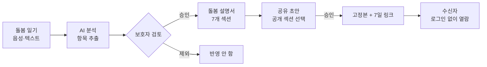
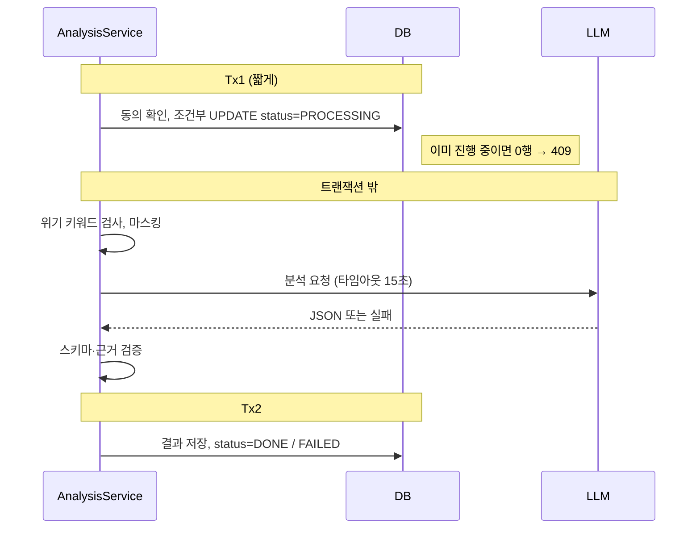
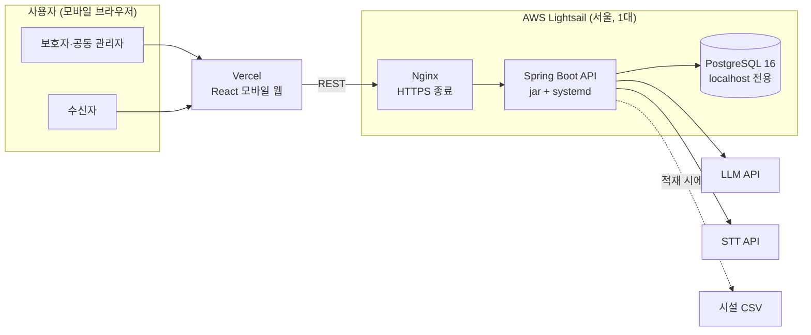
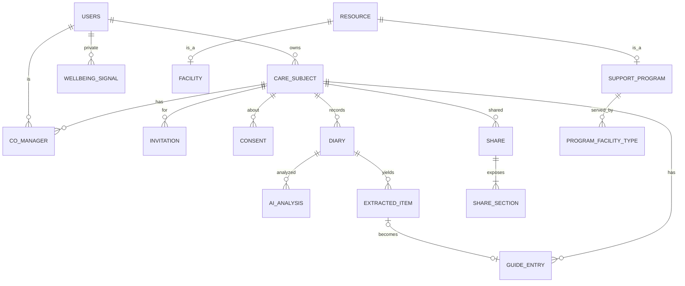

<p align="center">
  
</p>

# 돌봄바통 (Batong) — Backend

[](https://github.com/yongyong-18team/backend/actions/workflows/ci.yml)


> 보호자가 매일 쓰는 돌봄 일기를 AI가 정리하고, 보호자가 승인한 정보만 모아 **"이 사람을 돌보는 법" 설명서**로 만들어
> 다른 돌봄 제공자에게 링크 하나로 넘겨주는 서비스입니다.

발달장애인 보호자는 대상자의 습관, 불안해하는 상황, 진정시키는 방법을 머릿속에만 갖고 있는 경우가 많습니다. 보호자가 입원하거나 활동지원사가 바뀌면 이 정보가 끊기고, 그 공백이 곧 돌봄 공백이 됩니다. 돌봄바통은 이 정보를 기록 → 정리 → 공유하는 흐름을 만들어, 돌봄을 이어달리기의 바통처럼 안전하게 넘겨주는 것을 목표로 합니다.

해커톤 MVP이며 **가상 데이터만** 사용합니다.

| 바로가기 | |
|---|---|
| 서비스 화면 (React 모바일 웹) | https://yongyong-18team-frontend.vercel.app |
| API 서버 / Swagger UI | https://batong-team18.duckdns.org/swagger-ui/index.html |

---

## 목차

- [핵심 흐름](#핵심-흐름)
- [주요 기능](#주요-기능)
- [기술적으로 고민한 부분](#기술적으로-고민한-부분)
- [아키텍처](#아키텍처)
- [기술 스택](#기술-스택)
- [데이터 모델](#데이터-모델)
- [프로젝트 구조](#프로젝트-구조)
- [로컬 실행](#로컬-실행)
- [협업 방식](#협업-방식)
- [현재 상태](#현재-상태)
- [알려진 한계](#알려진-한계)
- [문서](#문서)

---

## 핵심 흐름



- **AI는 제안만 하고, 반영은 보호자가 결정합니다.** 설명서와 공유 문서에는 보호자가 승인했거나 직접 입력한 정보만 들어갑니다.
- **공유는 승인 시점의 고정본입니다.** 이후 설명서를 고쳐도 이미 보낸 링크의 내용은 바뀌지 않고, 7일 뒤 만료되거나 보호자가 언제든 막을 수 있습니다.

## 주요 기능

| 영역 | 내용 | API |
|---|---|---|
| 온보딩 | 보호자 프로필, 대상자, 돌봄 프로필 질문 5개, 동의를 한 번에 등록하고 초기 설명서 생성 | ONB-01 |
| 돌봄 일기 | 음성 녹음(STT) 또는 텍스트로 작성. 음성은 저장하지 않음 | STT-01, DIARY-01~05 |
| AI 분석 | 일기에서 행동·트리거·대처·복약 등 항목 추출, 공감 문장, 위기·소진 신호 판정 | DIARY-02 |
| 검토·반영 | 추출 항목을 선택·수정해 설명서에 반영. 같은 내용 중복 저장 방지 | ITEM-01 |
| 돌봄 설명서 | 절대 금지, 건강 위험, 의사소통, 행동·위기 대응, 일과, 복약, 선호·비선호 | GUIDE-01~04 |
| 기록 | 일일 기록, 최근 7일 주간 리포트(반복 행동, 시간대 패턴, 주요 변화) | REPORT-01~03 |
| 공유 | 문서 유형(설명서·일일)과 공개 섹션을 골라 고정본 링크 발급, 내역 관리, 접근 중지. 주간 리포트 공유는 MVP 이후 | SHARE-01~05, PUB-01 |
| 공동 관리자 | 가족을 초대해 설명서 열람·공유·돌봄 지원을 함께 사용. 일기 원문은 비공개 | INVITE-01~06, MEMBER-01~03 |
| 돌봄 지원 | 단기·장기, 날짜, 지역 조건으로 용인시 시설과 지원 제도 검색 | RES-01~02 |
| 보호자 지원 | 소진 신호가 누적되면 휴식·상담 제도 안내, 위기 표현이 있으면 안전 안내 | SUP-01~02 |

명세의 API 47개 중 45개를 구현했고, 에러 코드는 42개입니다. 구현하지 않은 2개는 AI_MODE 런타임 전환(ADMIN-02, 환경변수 변경과 재시작으로 대체)과 MVP 이후 범위인 GAP-06입니다. 전체 목록은 [API 명세](docs/API_명세_v1.4.md)에 있습니다.

---

## 기술적으로 고민한 부분

### 1. LLM 출력을 그대로 믿지 않는다

돌봄 정보는 틀리면 사람이 다칠 수 있습니다. 그래서 **LLM은 라벨과 문장만 만들고, 판단은 서버가 합니다.**

- **위기 이중 판정**: 서버의 위기 표현 사전과 LLM의 `safety_level` 중 하나라도 CRISIS면 CRISIS로 처리합니다. LLM 호출이 실패해도 키워드가 걸리면 CRISIS로 응답합니다. 위기를 놓치는 비용이 오탐보다 훨씬 크기 때문에 오탐은 허용하고, 대신 키워드를 보호자 1인칭 표현으로 좁히고 평가셋의 혼동 사례로 오탐률을 측정합니다.
- **위기 시 차단**: CRISIS로 판정된 일기는 저장만 하고, 공감 문장과 추출 항목은 저장하지도 응답하지도 않습니다. 이 규칙은 DB CHECK 제약(`safety_level = 'CRISIS'`이면 `empathy_text IS NULL`)으로도 막습니다.
- **근거 문장 검증**: 추출 항목마다 원문 근거(`evidence_quote`)를 받고, 그 문장이 실제 일기에 있는지 공백·문장부호를 정규화해 비교합니다. 근거가 없는 항목은 버려서 LLM이 지어낸 정보가 설명서에 들어가지 않게 합니다.
- **값 검증**: category, time_slot, label이 정해진 값이 아니면 버리거나 정규화합니다.
- **전송 전 마스킹**: LLM에 보내기 전에 대상자 이름을 "대상자"로 바꾸고 전화번호 패턴을 지웁니다. 비상 연락처는 보내지 않습니다.

### 2. LLM 호출을 DB 트랜잭션 밖으로

LLM 응답은 최대 수십 초가 걸립니다. 트랜잭션 안에서 기다리면 커넥션 풀이 금방 바닥납니다.



- 조건부 UPDATE로 같은 일기의 동시 분석 요청을 409로 막습니다. 별도 락이 필요 없습니다.
- 재시도는 5xx나 JSON 파싱 실패처럼 **즉시 실패한 경우에만 1회** 합니다. 타임아웃은 재시도하지 않고, 전체 상한 25초를 넘기면 FAILED로 둡니다. 라이브러리 없이 코드로 한 번만 재시도합니다.
- 서버가 중간에 죽어 PROCESSING에 남은 일기는 스케줄러가 2분 뒤 FAILED로 되돌려 재시도할 수 있게 합니다.

### 3. 링크 공유를 안전하게

수신자(활동지원사, 학교 선생님 등)는 계정이 없습니다. 링크 자체가 권한이므로 링크를 다루는 방식이 보안의 전부입니다.

- `SecureRandom` 32바이트 토큰을 base64url로 인코딩하고, **DB에는 SHA-256 해시만 저장합니다.** 원문 링크는 승인 응답에서 한 번만 내려주고, 다시 복사할 수 없습니다.
- 공개 API는 `snapshot_json`(승인 시점 고정본)만 읽고 다른 테이블은 조회하지 않습니다. 설명서가 바뀌어도, DB의 다른 데이터가 어떻게 되어도 수신자가 보는 범위는 보호자가 승인한 내용을 벗어나지 않습니다.
- 공유 상태(초안·활성·만료·철회)는 저장하지 않고 `approved_at`, `expires_at`, `revoked_at`으로 조회 시점에 계산합니다. 상태 불일치가 생길 수 없습니다.
- 응답에 `Cache-Control: no-store`, `Referrer-Policy: no-referrer`, `X-Robots-Tag: noindex`를 붙이고, IP당 분당 30회로 제한하며, Nginx access log에서 토큰 경로를 마스킹합니다.
- 만료 30일 뒤 고정본을 파기하고, 공동 관리자를 해제하면 그 사람이 만든 활성 링크를 같은 트랜잭션에서 철회합니다.

### 4. 권한은 서버가, 요청마다

- `/subjects/{subjectId}/**` 요청마다 역할(OWNER / CO_MANAGER / NONE)을 DB에서 판정합니다. 토큰에 역할을 넣지 않기 때문에 공동 관리자 해제나 탈퇴가 즉시 반영됩니다.
- 컨트롤러의 `@RequireRole`(인터셉터)과 서비스 계층의 소유 관계 확인을 **양쪽에** 둡니다. 화면에서 버튼을 숨기는 것은 권한 처리로 보지 않습니다.
- 공동 관리자는 설명서 전체와 승인된 기록은 보지만 **일기 원문은 받지 못합니다.**

### 5. 민감 정보를 구조적으로 분리

- 보호자의 소진·위기 신호(`wellbeing_signal`)는 공유·설명서 테이블과 연결 경로가 없고, 어떤 API 응답에도 들어가지 않습니다. LLM 출력 스키마에도 보호자 상태 카테고리를 두지 않고 boolean으로만 받습니다.
- LLM 원본 응답(`ai_analysis.raw_json`)은 디버깅용으로만 저장하고 노출하지 않습니다.
- 로그에 일기 본문, LLM 요청·응답, 비밀번호, 토큰을 남기지 않습니다.
- 공개 레포이므로 비밀값은 `.env`와 GitHub Secrets에만 둡니다. local 외 프로필에서 `JWT_SECRET`이 비어 있거나 32바이트 미만이면 **기동 자체를 실패**시키고, 관리자 키가 비어 있으면 관리자 API는 항상 거부합니다(비교는 `MessageDigest.isEqual`로 상수 시간).

### 6. 외부 장애에도 시연이 멈추지 않게

- LLM(Gemini)과 STT(Groq Whisper)는 인터페이스 뒤에 두고 환경변수로 공급자를 고릅니다. 공급자를 바꿔도 나머지 코드는 바뀌지 않습니다.
- `AI_MODE=mock`이면 평가셋 정답 응답을 돌려줍니다. 로컬 개발, CI, 시연 중 장애 대응에 같이 씁니다.
- 시설 데이터는 사용자 요청 중에 외부 API를 부르지 않고, 공식 자료를 정리한 CSV를 관리자 API(ADMIN-01)로 미리 DB에 적재합니다. 데이터 출처와 한계는 [공공데이터 활용 정리](docs/공공데이터_활용_정리.md)에 있습니다.

### 7. 스키마로 규칙을 강제

- 계산할 수 있는 값(나이, 공유 상태, 검토 상태, 설명서 갱신일)은 저장하지 않고 BCNF/3NF를 점검했습니다. 의도적 비정규화는 검색용 `facility.district` 한 건입니다.
- 부분 유니크 인덱스(같은 대상자에게 대기 중 초대는 하나만), CHECK 제약(유효기간 7일 고정, 승인 여부와 토큰 존재 일치)으로 서비스 코드가 놓쳐도 DB가 막게 했습니다.
- 스키마는 Flyway로만 바꾸고 `ddl-auto=validate`로 엔티티와 스키마가 어긋나면 앱이 뜨지 않게 합니다.

---

## 아키텍처



2주 해커톤과 소규모 트래픽에 맞춰 EC2 + RDS 대신 Lightsail 한 대에 Nginx, 애플리케이션, DB를 올렸습니다. DB는 외부 포트를 열지 않고, 방화벽은 22·80·443만 엽니다. 배포는 Docker 이미지 없이 jar를 scp로 올리고 `deploy.sh`가 교체·재시작·헬스체크를 하며, 실패하면 이전 jar로 되돌립니다.

## 기술 스택

| 영역 | 사용 |
|---|---|
| Language / Framework | Java 17, Spring Boot 3.5.16 (Web, Validation, Data JPA, Security, Actuator) |
| DB / Migration | PostgreSQL 16, Flyway, JSONB(`@JdbcTypeCode`) |
| 인증 | Spring Security, JWT(jjwt 0.12), BCrypt |
| 외부 연동 | Spring `RestClient`: LLM(Gemini), STT(Groq Whisper `whisper-large-v3`). 시설 데이터는 정리한 CSV를 적재 |
| 문서 | springdoc-openapi (Swagger UI) |
| 테스트 | JUnit 5, Mockito, Testcontainers |
| 빌드 / CI·CD | Gradle 8.14.3, GitHub Actions, systemd |
| 인프라 | AWS Lightsail(Ubuntu 24.04), Nginx, Let's Encrypt |
| 프론트 (별도 레포) | React 모바일 웹, Vercel |

## 데이터 모델

MVP 테이블 16개. 전체 컬럼과 제약은 [ERD 문서](docs/ERD_v1.4.md)에 있습니다.



## 프로젝트 구조

```
com.batong
 ├─ global        보안, 예외, 응답 포맷, 설정, 요청 제한
 ├─ auth          로그인, JWT
 ├─ user          내 정보, 탈퇴
 ├─ subject       대상자, 동의, 온보딩
 ├─ member        초대, 공동 관리자, 역할 판정
 ├─ diary         돌봄 일기
 ├─ analysis      AI 분석 오케스트레이션, 위기 판정
 ├─ guide         설명서, 추출 항목 승인
 ├─ report        일일·주간 리포트
 ├─ share         공유 초안·승인·토큰·공개 열람
 ├─ resource      지원 제도·시설 조건 검색, 상세
 ├─ support       소진 지원·위기 안전 안내
 ├─ wellbeing     소진·위기 신호 (비공개)
 ├─ scheduler     공유 초안 정리, 고정본 파기, 멈춘 분석 복구
 └─ infra
     ├─ llm        LlmClient + Gemini 구현 + Mock
     ├─ stt        SttClient + Groq 구현 + Mock
     └─ publicdata 시설 CSV 적재
```

도메인마다 `controller / service / repository / domain / dto`로 나눕니다. 응답은 `ApiResponse<T>`로 감싸고, 에러는 `BusinessException(ErrorCode)`로 던집니다. 엔티티에는 setter를 두지 않고, DTO는 record로 씁니다.

## 로컬 실행

준비물: JDK 17, Docker

```bash
cp .env.example .env
docker compose up -d db                                     # 로컬 PostgreSQL
./gradlew bootRun --args='--spring.profiles.active=local'   # AI_MODE=mock
```

- Swagger UI: http://localhost:8080/swagger-ui/index.html
- 테스트: `./gradlew test` (Testcontainers를 쓰므로 Docker가 켜져 있어야 합니다)
- 로컬 DB 초기화: `docker compose down -v && docker compose up -d db`

## 협업 방식

백엔드 3명, 프론트 2명이 2주 동안 같이 작업합니다.

| 담당 | 범위 |
|---|---|
| 백엔드 A | global, auth, user, member, guide, share, 인프라·CI/CD |
| 백엔드 B | subject(온보딩), diary, analysis, infra.llm, infra.stt |
| 백엔드 C | report, support, wellbeing, infra.publicdata, 스케줄러 |

- **이슈 → 브랜치 → PR → 리뷰 → Squash Merge → 자동 배포.** API ID 단위로 이슈를 나누고, 브랜치는 `{type}/{이슈번호}-{설명}`, 제목은 Conventional Commits 형식을 씁니다.
- `main`은 ruleset으로 보호합니다. 승인 1명과 CI `build` 통과가 있어야 머지되고, force push와 삭제는 막혀 있습니다.
- 공통 코드(`global/`, `build.gradle`, `docs/`)는 CODEOWNERS로 담당자에게 리뷰가 자동 요청됩니다.
- **문서가 기준입니다.** 테이블·API·에러 코드는 v1.4 문서를 그대로 따르고, 명세에 없는 필드나 API는 만들지 않습니다. 모호하면 구현하지 않고 이슈로 묻습니다.
- **AI 코딩 도구용 규칙을 레포에 둡니다.** [`AGENTS.md`](AGENTS.md)에 버전 주의사항(Boot 3.5, jakarta, jjwt 0.12 등), 보안 규칙, 담당 범위를 적어 두어 어떤 도구를 쓰든 같은 규칙으로 코드를 만들게 했습니다. 자세한 내용은 [CONTRIBUTING.md](CONTRIBUTING.md)에 있습니다.

## 현재 상태

- [x] 설계 문서 v1.4 (TRD, ERD, API 명세, AI 명세)
- [x] 프로젝트 골격, CI, 브랜치 보호
- [x] global 공통 모듈 (응답·예외·JWT·Security·`@RequireRole`)
- [x] Flyway V1 전체 스키마 (테이블 16개)
- [x] 도메인 API 45개 구현
- [x] AI 평가셋 30건과 Mock 응답, Gemini·Groq 클라이언트
- [x] 서버 배포, HTTPS
- [ ] 시연용 데모 시드 데이터 (리뷰 중)
- [ ] 시연 리허설

## 알려진 한계

- 주간 리포트 공유(WEEKLY)는 구현하지 않았습니다. 공유는 돌봄 설명서와 일일 기록만 됩니다.
- AI_MODE 런타임 전환 API(ADMIN-02)는 만들지 않았습니다. `.env`의 `AI_MODE`를 바꾸고 재시작합니다.
- 로그인은 ID·비밀번호만 지원합니다. 소셜 로그인은 없습니다.
- 서버가 한 대라서 요청 제한(로그인, 멤버 조회, 공개 링크)은 서버 메모리에 둡니다. 재시작하면 초기화되고, 서버를 늘리면 DB나 Redis로 옮겨야 합니다.

## 문서

| 문서 | 내용 |
|---|---|
| [TRD](docs/TRD_v1.4.md) | 아키텍처, 인증·인가, AI 처리 흐름, 인프라, 비기능 요구사항 |
| [ERD](docs/ERD_v1.4.md) | 테이블 명세, 삭제 정책, 정규화 점검 |
| [API 명세](docs/API_명세_v1.4.md) | 엔드포인트, 요청·응답, 에러 코드 |
| [AI 명세](docs/AI_명세_v1.4.md) | 프롬프트, 출력 스키마, 마스킹, 위기 사전, 평가셋 |
| [DEPLOY](DEPLOY.md) | 서버 구성, 배포, 장애 대응 |
| [CONTRIBUTING](CONTRIBUTING.md) | 협업 규칙 |
