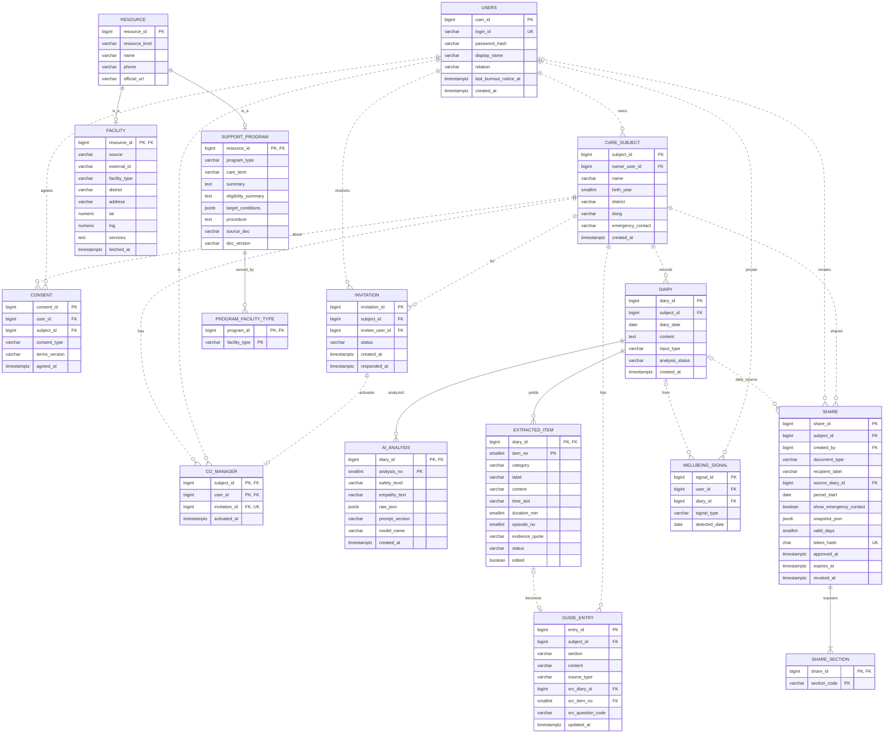

# 돌봄 바통 ERD v1.4

## 0. 문서 정보

| 항목 | 내용 |
|---|---|
| 작성자 | 백엔드 A |
| 관련 문서 | 기획서, PRD(2026-11-03 수정본), 와이어프레임, TRD v1.4, API 명세 v1.4, AI 명세 v1.4 |

### 변경 이력

| 버전 | 날짜 | 내용 |
|---|---|---|
| 1.0 | 2026-11-01 | 최초 작성 |
| 1.1 | 2026-11-02 | 팀 댓글 반영 (raw_json NULL 허용, LEFT 제거, MANUAL 출처, label 목록 등) |
| 1.2 | 2026-11-03 | PRD 수정본 반영. 온보딩 4단계 일괄 저장(onboarding_answer 삭제), 대상자 이름·출생 연도·세부 지역·비상 연락처, 보호자 관계를 users로 이동, care_subject_need 삭제, 설명서 섹션 7종 재정의, 공유 수신자 유형 삭제·비상 연락처 표시 여부 추가·유효기간 7일 고정·주간 기간을 최근 7일로, 돌봄 공백 저장(care_gap·gap_recommendation)을 P1로 이동 |
| 1.3 | 2026-11-03 | 플랫폼 확정(React 모바일 웹)에 맞춰 문서 버전만 맞춤. 스키마 변경 없음 |
| 1.4 | 2026-11-03 | 서버 구성 변경(Lightsail)에 맞춰 문서 버전만 맞춤. 스키마 변경 없음 |

---

## 1. 설계 기준

- 방법론: 실버샤츠 『Database System Concepts』(7판 6·7장). E-R 모델링 → 관계 스키마 변환 → 정규화(BCNF/3NF) 점검
- DB: PostgreSQL 16
- 확정 결정
  - 공유: 랜덤 토큰 링크 + 7일 만료 + 철회. 수신자 확인 절차 없음, 수신자 유형 구분 없음
  - 위기 판정: 일기는 저장, 공감 문장·정보 추출 안 함
  - 공동 관리자: 고정 권한(설명서 열람·공유·돌봄 지원). 해제는 주 보호자만
  - 공동 관리자 조회 범위: 설명서 전체, 일일·주간 기록은 승인 정보만, 일기 원문 불가
- 공통 규칙
  - PK는 BIGINT 자동 증가
  - 시각 TIMESTAMPTZ (Java `Instant`), 날짜 DATE (Java `LocalDate`, KST)
  - enum은 VARCHAR (JPA `@Enumerated(STRING)`)
  - 계산 가능한 상태값은 저장하지 않음 (유도 속성)

---

## 2. ERD (Mermaid)

실선(`--`)은 식별 관계(약한 개체, 다중값 속성, 상속), 점선(`..`)은 비식별 관계다. P1 테이블(care_gap, gap_recommendation 등)은 3-5에 있다.

---

## 3. 테이블 명세

### 3-1. 계정·권한

**users**

| 컬럼 | 타입 | 제약 | 설명 |
|---|---|---|---|
| user_id | BIGINT | PK | |
| login_id | VARCHAR(20) | UQ, NOT NULL | 4~20자, 영문 소문자·숫자. 공동 관리자 초대에 사용 |
| password_hash | VARCHAR(100) | NOT NULL | BCrypt |
| display_name | VARCHAR(30) | NULL | 보호자 이름 (0.2-1). 입력 전에는 화면에 login_id 표시 |
| relation | VARCHAR(10) | NULL | PARENT / OTHER (0.2-1 보호자 관계). 6.1·6.3에 표시 |
| last_burnout_notice_at | TIMESTAMPTZ | NULL | 소진 재안내 주기(14일) 판단용 |
| created_at / updated_at | TIMESTAMPTZ | NOT NULL | |

- 관계를 사용자에 두는 이유: 6.3 공동 관리자 목록에 각자의 관계를 표시한다. MVP는 사용자당 대상자 1명을 가정한다.

**care_subject**

| 컬럼 | 타입 | 제약 | 설명 |
|---|---|---|---|
| subject_id | BIGINT | PK | |
| owner_user_id | BIGINT | FK users, NOT NULL, CASCADE | 주 보호자 (정확히 1명) |
| name | VARCHAR(20) | NOT NULL, CHECK 길이 2~20 | 부르는 이름 (실명 대신 별칭 가능). 2자 이상은 LLM 마스킹 때문 |
| birth_year | SMALLINT | NOT NULL, CHECK 1930~현재 연도 | 나이는 저장하지 않고 계산 (유도 속성) |
| district | VARCHAR(10) | NOT NULL | CHEOIN / GIHEUNG / SUJI |
| dong | VARCHAR(20) | NULL | 세부 지역 (구 선택 후 드롭다운) |
| emergency_contact | VARCHAR(100) | NULL | 비상 연락처. 3.1 기본 정보, 3.2에서 입력. LLM에 보내지 않음 |
| created_at / updated_at | TIMESTAMPTZ | NOT NULL | |

**consent**

| 컬럼 | 타입 | 제약 | 설명 |
|---|---|---|---|
| consent_id | BIGINT | PK | |
| user_id | BIGINT | FK, CASCADE | |
| subject_id | BIGINT | FK, CASCADE | |
| consent_type | VARCHAR(30) | NOT NULL | PRIVACY / SENSITIVE_INFO / AI_PROCESSING / SUBJECT_AUTHORITY |
| terms_version | VARCHAR(10) | NOT NULL | |
| agreed_at | TIMESTAMPTZ | NOT NULL | |
| | | UQ(user_id, subject_id, consent_type, terms_version) | |

- 0.2-4의 "민감정보·AI 동의" 체크박스 하나는 SENSITIVE_INFO와 AI_PROCESSING 두 행으로 저장한다.

**invitation**

| 컬럼 | 타입 | 제약 | 설명 |
|---|---|---|---|
| invitation_id | BIGINT | PK | |
| subject_id | BIGINT | FK, CASCADE | 초대한 사람은 subject.owner로 유도 |
| invitee_user_id | BIGINT | FK users, CASCADE | |
| status | VARCHAR(10) | NOT NULL | PENDING / ACCEPTED / REJECTED / CANCELED / REVOKED |
| created_at | TIMESTAMPTZ | NOT NULL | |
| responded_at | TIMESTAMPTZ | NULL | |
| | | 부분 UQ(subject_id, invitee_user_id) WHERE status = 'PENDING' | |

- 권한은 고정이므로 권한 컬럼이 없다. PRD 7-3의 `permissions`는 화면 표시용 목록이며 저장하지 않는다.

**co_manager** (CO_MANAGES 관계, M:N)

| 컬럼 | 타입 | 제약 | 설명 |
|---|---|---|---|
| subject_id | BIGINT | PK, FK, CASCADE | |
| user_id | BIGINT | PK, FK, CASCADE | |
| invitation_id | BIGINT | FK, UQ | |
| activated_at | TIMESTAMPTZ | NOT NULL | |

- 행이 있으면 활성 공동 관리자다. 해제(6.3)하면 행을 삭제하고 invitation을 REVOKED로, 그 사람이 만든 활성 공유의 revoked_at을 같은 트랜잭션에서 설정한다.

### 3-2. 기록·설명서

**diary**

| 컬럼 | 타입 | 제약 | 설명 |
|---|---|---|---|
| diary_id | BIGINT | PK | 작성자는 subject.owner로 유도 |
| subject_id | BIGINT | FK, CASCADE | |
| diary_date | DATE | NOT NULL | |
| content | TEXT | NOT NULL | STT 결과를 보호자가 확인·수정한 최종본. 음성은 저장하지 않음 |
| input_type | VARCHAR(10) | NOT NULL | VOICE / TEXT |
| analysis_status | VARCHAR(12) | NOT NULL | PENDING / PROCESSING / DONE / FAILED |
| created_at / updated_at | TIMESTAMPTZ | | |
| | | INDEX(subject_id, diary_date) | |

- 검토 상태(PRD 7-1 review_status)는 저장하지 않는다. extracted_item에 PENDING이 남아 있으면 "검토 대기"로 계산한다.

**ai_analysis** (DIARY의 약한 개체)

| 컬럼 | 타입 | 제약 | 설명 |
|---|---|---|---|
| diary_id | BIGINT | PK, FK, CASCADE | |
| analysis_no | SMALLINT | PK | 재분석 시 증가 |
| safety_level | VARCHAR(10) | NOT NULL | NORMAL / CRISIS |
| empathy_text | VARCHAR(300) | NULL | CHECK: CRISIS면 NULL |
| raw_json | JSONB | NULL | LLM 원본. LLM 실패 + 키워드 적중 CRISIS면 NULL. 어떤 API로도 노출 금지 |
| prompt_version | VARCHAR(20) | NOT NULL | 키워드만으로 판정하면 `keyword-only` |
| model_name | VARCHAR(50) | NULL | 위와 같은 경우 NULL |
| created_at | TIMESTAMPTZ | | |

**extracted_item** (DIARY의 약한 개체)

| 컬럼 | 타입 | 제약 | 설명 |
|---|---|---|---|
| diary_id | BIGINT | PK, FK, CASCADE | |
| item_no | SMALLINT | PK | 재분석 시 기존 최댓값 다음부터 |
| category | VARCHAR(20) | NOT NULL | 아래 매핑표 |
| label | VARCHAR(30) | NULL | BEHAVIOR일 때만 9개 값 중 하나 |
| content | VARCHAR(500) | NOT NULL | |
| time_slot | VARCHAR(10) | NULL | MORNING / AFTERNOON / EVENING / NIGHT |
| duration_min | SMALLINT | NULL | |
| episode_no | SMALLINT | NULL | 같은 사건의 트리거·행동·대처 묶음 |
| evidence_quote | VARCHAR(500) | NOT NULL | 원문 근거 |
| status | VARCHAR(10) | NOT NULL | PENDING / APPROVED / EXCLUDED |
| edited | BOOLEAN | DEFAULT false | |

- label 값: 소리 지름 / 자해 행동 / 타인 공격 / 물건 파손 / 뛰쳐나감 / 반복 행동 / 수면 문제 / 식사 거부 / 기타 행동

**설명서 섹션** (PRD 3.1 기준, 기본 정보 제외 7종)

| 섹션 코드 | 화면 이름 | 일기에서 오는 category | 온보딩 질문 (0.2-3) |
|---|---|---|---|
| PROHIBITED | 절대 금지 | 없음 (직접 입력만) | |
| HEALTH_RISK | 건강 위험 요소 | 없음 (직접 입력만) | |
| COMMUNICATION | 의사소통 방법 | COMMUNICATION | Q5 |
| BEHAVIOR_RESPONSE | 행동 특성 및 위기 대응 | BEHAVIOR, TRIGGER, RESPONSE | Q3, Q4 |
| DAILY_LIFE | 하루 일과 및 생활 습관 | ROUTINE, CONDITION | Q1 |
| MEDICATION | 복약 정보·주의사항 | MEDICATION, MEAL | Q2 |
| PREFERENCE | 선호·비선호 | PREFERENCE, AVERSION | |

- 기본 정보(이름, 나이, 지역, 비상 연락처)는 care_subject에서 렌더링한다.
- 절대 금지·건강 위험 요소는 의료·안전 판단이 들어가므로 AI가 만들지 않고 보호자가 3.2에서 직접 입력한다.
- category → 섹션 매핑은 코드 enum으로 관리한다(컬럼으로 저장하면 3NF 위반).

**guide_entry**

| 컬럼 | 타입 | 제약 | 설명 |
|---|---|---|---|
| entry_id | BIGINT | PK | |
| subject_id | BIGINT | FK, CASCADE | |
| section | VARCHAR(20) | NOT NULL | 위 7종 |
| content | VARCHAR(500) | NOT NULL | |
| source_type | VARCHAR(12) | NOT NULL | ONBOARDING / DIARY / MANUAL |
| src_diary_id, src_item_no | BIGINT, SMALLINT | 복합 FK → extracted_item, SET NULL, UQ | 일대일(BECOMES) |
| src_question_code | VARCHAR(5) | NULL | 온보딩 출처 Q1~Q5 |
| created_at / updated_at | TIMESTAMPTZ | | 설명서 갱신일 = max(updated_at), 저장 안 함 |
| | | INDEX(subject_id, section) | |

- 중복 저장 방지(PRD 2.3): 같은 subject·section에 공백을 제거한 content가 같은 항목이 있으면 새로 만들지 않는다. 서비스 계층에서 검사한다.
- 공동 관리자는 설명서 전체를 조회한다. 항목별 공개 범위는 두지 않는다.

### 3-3. 공유

**share** (특수화: DAILY / WEEKLY / GUIDE, 단일 테이블 방식)

| 컬럼 | 타입 | 제약 | 설명 |
|---|---|---|---|
| share_id | BIGINT | PK | |
| subject_id | BIGINT | FK, CASCADE | |
| created_by | BIGINT | FK users, SET NULL | 초안 생성·승인자 |
| document_type | VARCHAR(10) | NOT NULL | DAILY / WEEKLY / GUIDE |
| recipient_label | VARCHAR(30) | NULL | 받는 사람 메모 (공유 내역 구분용) |
| source_diary_id | BIGINT | FK diary, SET NULL | DAILY 출처 |
| period_start | DATE | NULL | WEEKLY 출처. period_start ~ +6일. CHECK: WEEKLY면 NOT NULL |
| show_emergency_contact | BOOLEAN | NOT NULL, DEFAULT false | 4.1 비상 연락처 표시 여부 |
| snapshot_json | JSONB | NULL | 승인 시점 고정본. 만료 30일 후 NULL |
| valid_days | SMALLINT | NOT NULL, DEFAULT 7, CHECK = 7 | PRD 4.2·4.3 "생성 시점부터 7일" |
| token_hash | CHAR(64) | UQ, NULL | SHA-256. 원문은 승인 응답에서 한 번만 |
| approved_at | TIMESTAMPTZ | NULL | NULL이면 초안 |
| expires_at | TIMESTAMPTZ | NULL | 승인 시각 + 7일 |
| revoked_at | TIMESTAMPTZ | NULL | |
| created_at | TIMESTAMPTZ | | |
| | | CHECK: (approved_at IS NULL) = (token_hash IS NULL) | |

- 상태는 계산한다: approved_at 없음 → DRAFT, revoked_at 있음 → REVOKED, 현재가 expires_at 이후 → EXPIRED, 그 외 ACTIVE
- 수신자 유형은 MVP에서 두지 않는다(PRD 4.1).
- 링크는 내역에서 다시 복사할 수 없다(해시 저장).

**share_section** (다중값 속성)

| 컬럼 | 타입 | 제약 | 설명 |
|---|---|---|---|
| share_id | BIGINT | PK, FK, CASCADE | |
| section_code | VARCHAR(30) | PK | GUIDE·DAILY: 설명서 7개 섹션 / WEEKLY: WEEKLY_SUMMARY, DAILY_TREND, KEY_CHANGES |

### 3-4. 돌봄 지원

MVP의 5.1→5.2는 저장 없이 조건(단기/장기, 날짜, 지역)으로 검색한다(PRD 5.1 "직접 입력 기반"). 결과는 아래 자원 테이블에서 조회한다.

**resource** (일반화 상위 개체)

| 컬럼 | 타입 | 제약 | 설명 |
|---|---|---|---|
| resource_id | BIGINT | PK | |
| resource_kind | VARCHAR(10) | NOT NULL | FACILITY / PROGRAM |
| name | VARCHAR(100) | NOT NULL | |
| phone | VARCHAR(20) | NULL | |
| official_url | VARCHAR(300) | NULL | 5.2 정책 "정보 출처 및 공식 링크" |

**facility** (하위 개체, JPA JOINED 상속)

| 컬럼 | 타입 | 제약 | 설명 |
|---|---|---|---|
| resource_id | BIGINT | PK, FK, CASCADE | |
| source | VARCHAR(20) | NOT NULL | YONGIN_API / GG_DATADREAM / MANUAL |
| external_id | VARCHAR(50) | NOT NULL | UQ(source, external_id) |
| facility_type | VARCHAR(50) | NOT NULL | 단기거주시설, 주간보호시설, 발달장애인지원센터 등 |
| district | VARCHAR(10) | NOT NULL | 검색용 의도적 비정규화 |
| address | VARCHAR(200) | | |
| lat / lng | NUMERIC(9,6) | NULL | |
| services | TEXT | NULL | |
| fetched_at | TIMESTAMPTZ | NOT NULL | |
| | | INDEX(facility_type, district) | |

**support_program** (하위 개체)

| 컬럼 | 타입 | 제약 | 설명 |
|---|---|---|---|
| resource_id | BIGINT | PK, FK, CASCADE | |
| program_type | VARCHAR(30) | NOT NULL | EMERGENCY_CARE / DAY_ACTIVITY / ACTIVITY_SUPPORT / FAMILY_REST / PARENT_COUNSELING |
| care_term | VARCHAR(10) | NOT NULL | SHORT / LONG / BOTH (5.1 단기·장기 분기) |
| summary | TEXT | | |
| eligibility_summary | TEXT | | 사람이 읽는 이용 조건 (5.3) |
| target_conditions | JSONB | NOT NULL | 나이 범위 등 매칭 규칙 |
| procedure | TEXT | | 신청 절차 |
| source_doc / doc_version | VARCHAR | | 근거 지침·연도 |

**program_facility_type**

| 컬럼 | 타입 | 제약 | 설명 |
|---|---|---|---|
| program_id | BIGINT | PK, FK support_program | |
| facility_type | VARCHAR(50) | PK | 예: 긴급돌봄 → 단기거주시설 |

**wellbeing_signal** (비공개)

| 컬럼 | 타입 | 제약 | 설명 |
|---|---|---|---|
| signal_id | BIGINT | PK | |
| user_id | BIGINT | FK users, CASCADE | 주 보호자 |
| diary_id | BIGINT | FK diary, SET NULL | |
| signal_type | VARCHAR(10) | NOT NULL | BURNOUT / CRISIS |
| detected_date | DATE | NOT NULL | |
| created_at | TIMESTAMPTZ | | |
| | | UQ(user_id, signal_type, detected_date) | 같은 날 중복 집계 방지 |

- share, guide_entry와 연결 경로가 없다. 주 보호자 본인 API에서만 조회한다.

### 3-5. P1 (MVP 이후)

| 테이블 | 용도 | 주요 컬럼 |
|---|---|---|
| care_gap | AI가 일기에서 감지한 돌봄 공백 저장·확인 | gap_id, subject_id, detected_diary_id, care_term, needed_date, district, status(DETECTED/CONFIRMED/DISMISSED) |
| gap_recommendation | 공백별 추천 결과 저장 | gap_id, resource_id, rank, reason_text |
| share_access_log | 공유 열람 이력 | share_id, seq, accessed_at |
| weekly_report | 주간 리포트 캐시 | subject_id, period_start, summary_json |

---

## 4. 삭제 정책

| 이벤트 | 처리 |
|---|---|
| 일기 삭제 (2.4) | ai_analysis, extracted_item CASCADE. guide_entry 출처, share.source_diary_id, wellbeing_signal.diary_id는 SET NULL |
| 주 보호자 탈퇴 | users → care_subject CASCADE로 하위 데이터 전체 삭제. 공유 링크 무효 |
| 공동 관리자 해제 (6.3) | co_manager 행 삭제, invitation → REVOKED, 그 사람이 만든 활성 공유 revoked_at 설정 |
| 공동 관리자 탈퇴 | co_manager 행 삭제, share.created_by SET NULL |
| 공유 만료 + 30일 | 배치로 snapshot_json NULL |
| 승인 안 된 공유 초안 | 생성 1일 후 배치로 삭제 |

---

## 5. 정규화 점검

- 3NF 위반 제거: diary.author_id, invitation.owner_user_id (`subject_id → owner`), extracted_item.section (`category → section`)
- 유도 속성 미저장: 나이(birth_year에서), 공유 상태, 설명서 갱신일, 검토 상태, 받은 초대 목록, 일일 기록 문서
- 다중값 속성 분리: share_section
- 의도적 비정규화 1건: facility.district
- 나머지 BCNF. 후보키: login_id, token_hash, invitation_id(co_manager)

---

## 6. 확정 사항

| # | 항목 | 결정 |
|---|---|---|
| 1 | 공동 관리자 권한 | 고정 (설명서 열람·공유·돌봄 지원). 6.2 권한 목록은 표시용 |
| 2 | 공동 관리자 조회 범위 | 설명서 전체 / 일일·주간 기록은 승인 정보만 / 일기 원문 불가. 항목별 공개 범위 없음 |
| 3 | 스스로 나가기 | MVP 제외 (LEFT 상태 없음) |
| 4 | 해제 시 링크 | 해제된 공동 관리자가 만든 활성 링크 자동 철회 |
| 5 | 수신자 유형 | MVP 제외. 받는 사람 메모(recipient_label)만 선택 입력 |
| 6 | 공유 유효기간 | 7일 고정 |
| 7 | 돌봄 공백 | MVP는 저장 없는 조건 검색. AI 감지·저장은 P1 |
| 8 | 약한 개체 JPA 구현 | 대리키 + UNIQUE 허용 |
