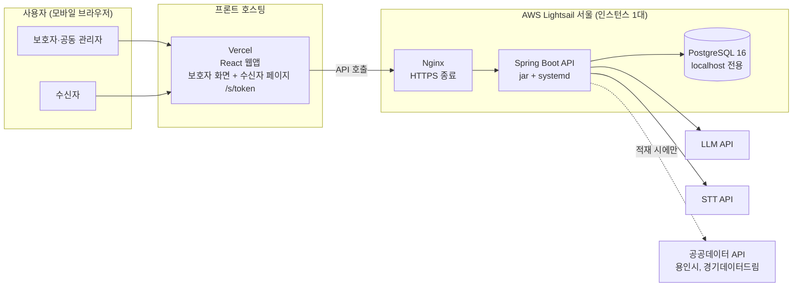
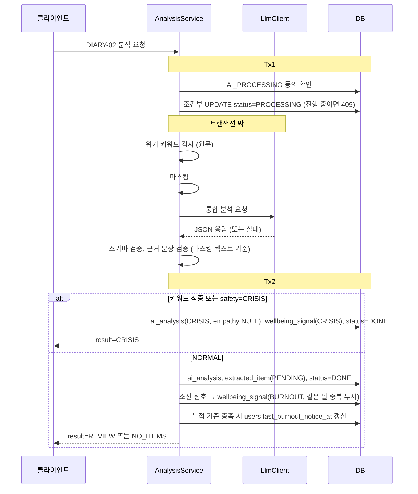

# 돌봄 바통 TRD v1.4

## 0. 문서 정보

| 항목 | 내용 |
|---|---|
| 작성자 | 백엔드 A |
| 관련 문서 | 기획서, PRD(2026-11-03 수정본), 와이어프레임, IA, ERD v1.4, API 명세 v1.4, AI 명세 v1.4 |

### 변경 이력

| 버전 | 날짜 | 내용 |
|---|---|---|
| 0.9 | 2026-11-01 | 초안 |
| 1.0 | 2026-11-01 | 양식 보완(용어, 가정·제약, 요구사항 추적표, NFR ID), 문서 간 불일치 정리, 분석 트랜잭션 분리 등 |
| 1.1 | 2026-11-02 | 팀 댓글·와이어프레임·PRD 최신본·기획서 대조 반영. 0.3→0.2 통합, 6.3 추가, 스스로 나가기 제외, AI 타임아웃 15초·재시도 조건, NFR-02 수정, 위기 오탐 허용 근거와 리스크 추가, 키워드 단독 판정 시 기록 방식, 주간 리포트 AI 요약(P1) 추가, 공유 유효기간을 기획서대로 보호자 선택(1·3·7일, 기본 7일)으로 변경, 지자체 집계 지표 범위 명시, PRD·기획서 확인 요청 목록 정리 |
| 1.2 | 2026-11-03 | PRD 수정본 반영. 온보딩 4단계 일괄 등록(AI 미사용), 설명서 섹션 재정의, 수신자 유형 제외, 공유 유효기간 7일 고정(PRD 4.2·4.3), 공동 관리자 조회 범위 확정, 돌봄 지원 조건 검색(저장 없음)·AI 공백 감지 P1, MVP LLM 호출을 AI-01 하나로 축소, 주간 리포트 최근 7일, 추적표 갱신, 담당 표기를 백엔드 A·B·C로 |
| 1.3 | 2026-11-03 | 클라이언트 플랫폼 확정: React 모바일 웹(보호자 화면과 수신자 페이지를 한 웹앱에서). 3-3 재작성, STT는 서버 STT-01로 확정(8-2), 웹 토큰 저장·CORS(7-1, 12-5), 홈 화면 추가(manifest), 브라우저 녹음 형식, 리스크·미결 사항 갱신. Spring Boot 3.5.16 확정(1-5, 4장), CI/CD를 jar + scp + systemd로 단순화하고 서버 환경을 하나로(12장), 공개 저장소 보안 설정, 개발 규약을 이슈·Conventional Commits 기준으로(15장) |
| 1.4 | 2026-11-03 | 서버를 EC2 + RDS에서 Lightsail 한 대(Nginx + Spring Boot + PostgreSQL)로 단순화. 3-1 구성도, 3-2, 4장, NFR-10·12, 12장(구성·환경·DB·백업·배포 Secrets 이름), 리스크 갱신. API·스키마·AI 처리 변경 없음 |

---

## 1. 개요

### 1-1. 목적
PRD의 기능 요구사항을 구현하기 위한 시스템 구조, 기술 스택, 데이터 처리, 보안, AI 처리 방식, 인프라, 개발 규약을 정의한다.

### 1-2. 범위
- 포함: PRD 6-1의 P0 전체, P1 주간 리포트, P1 6.3 공동 관리자 관리 화면
- P1(MVP 이후): AI 돌봄 공백 감지, 공유 문서 AI 요약(AI-03), 자원 추천 이유 AI 문장(AI-04)
- 제외: 실시간 기관 매칭, 자동 신청·예약, AI 심리 상담, 자동 신고, 기관 운영 대시보드, 푸시 알림, 공동 관리자 스스로 나가기, 수신자 유형별 맞춤 공유
- 참고: 기획서 BM의 지자체 집계 지표(설명서 갱신률, 지원제도 안내 실적)는 화면을 만들지 않는다. 다만 guide_entry.updated_at, share로 계산할 수 있어 발표 시 SQL 집계로 시연할 수 있다. 개인 단위 데이터가 아니라 집계값만 쓴다.

### 1-3. 용어

| 용어 | 정의 |
|---|---|
| 주 보호자 (OWNER) | 돌봄 대상자를 등록한 계정. 대상자당 1명 |
| 공동 관리자 (CO) | 주 보호자의 초대를 수락한 계정. 고정 권한(조회·공유·돌봄 지원) |
| 수신자 | 공유 링크로 문서를 열람하는 외부인. 계정 없음 |
| 승인 항목 | AI가 추출하고 주 보호자가 승인한 돌봄 정보. 설명서와 공유 문서의 유일한 원천 |
| 고정본 | 공유 승인 시점의 문서 내용(snapshot_json). 이후 설명서가 바뀌어도 변하지 않음 |
| 돌봄 공백 | 보호자 부재, 활동지원사 변경 등으로 돌봄이 끊기는 기간 |
| 소진 신호 / 위기 신호 | 일기에서 감지한 보호자 상태. 주 보호자 본인 외 접근 불가 |

### 1-4. 가정·제약
- 해커톤 MVP다. 실사용자 데이터 없이 가상 데이터만 쓴다.
- 서버는 단일 인스턴스로 운영한다.
- 클라이언트는 React 모바일 웹이다(2026-11-03 프론트 결정). 프론트 두 명 모두 Android 실프로젝트 경험이 없고, 2주 안에 시연 완성도를 내는 것을 우선했다. 실서비스는 Android 앱으로 확장할 수 있다. 서버 API는 앱으로 바뀌어도 그대로 쓴다.
- LLM 공급자, STT 공급자는 미정이다. 어댑터 뒤에 두어 정해져도 다른 코드는 바뀌지 않게 한다.
- 공공데이터에 용인 데이터가 있는지 기획이 확인 중이다.

### 1-5. 결정 사항

| 항목 | 결정 | 이유 |
|---|---|---|
| 수신자 접근 | 별도 확인 절차 없이 랜덤 토큰 링크 + 만료 + 철회 | PRD 1-3, 5-3 |
| 공유 링크 재복사 | 지원 안 함. 발급 직후 화면에서만 복사 | 토큰 해시 저장 유지 |
| 공유 유효기간 | 7일 고정 | PRD 4.2·4.3 "생성 시점부터 7일". 4.1에 기간 선택 UI 없음 |
| 수신자 유형 | MVP 제외. 받는 사람 메모만 선택 입력 | PRD 4.1, 기획 합의(2026-11-02). 핵심 기능 2를 "보호자 주도 맞춤형 공유"로 변경 |
| 위기 판정 시 | 일기 저장, 공감·추출 안 함 | PRD 2-4, 5.5 |
| 공동 관리자 권한 | 고정 (설명서 열람·공유·돌봄 지원). 6.2 권한 목록은 표시용 | PRD 6.2, 기획 합의 |
| 공동 관리자 조회 범위 | 설명서 전체 / 일일·주간 기록은 승인 정보만 / 일기 원문 불가. 항목별 공개 범위 없음 | 기획 합의(2026-11-02) |
| 온보딩 | 0.2-1~0.2-4 입력을 마지막에 한 번에 등록. 질문 답변은 AI 없이 섹션별 항목으로 저장 | PRD 0.2-3·0.2-4 |
| 돌봄 지원 | 조건(단기·장기, 날짜, 지역)으로 검색, 저장 없음. AI 공백 감지는 P1 | PRD 5.1 "MVP는 직접 입력 기반" |
| 공동 관리자 삭제 | 주 보호자만 (6.3). 삭제 시 그 사람이 만든 활성 링크 자동 철회 | PRD 6.3, 5-3 |
| 스스로 나가기 | MVP 제외 | 와이어프레임에 화면 없음 |
| 클라이언트 플랫폼 | React 모바일 웹. 수신자 페이지(4.4)도 같은 웹앱의 `/s/{token}` 경로 | 프론트 결정(2026-11-03). PRD 4.4 "앱 설치 없이 링크로 열람"을 별도 작업 없이 충족 |
| STT | 서버에서 변환(STT-01). 브라우저 녹음 → 서버 → STT API | 웹 브라우저마다 내장 음성 인식 지원이 달라 서버 한 곳에서 처리 |
| JWT | Access 7일 단일 토큰, Refresh 없음 | ERD 변경 없음, 고령 사용자 재로그인 최소화 |
| Spring Boot | 3.5.16, Java 17 | 팀 학습 환경과 같고 자료·AI 생성 코드가 가장 많다. 3.5 오픈소스 지원은 2026-06-30에 끝났지만 2주 해커톤, 가상 데이터라 영향이 작다. 실서비스 전 4.x로 올린다 |

### 1-6. 설계 원칙
1. 권한은 서버가 판단한다. 클라이언트에서 화면을 숨기는 것은 권한 처리로 보지 않는다(PRD 7-3).
2. LLM은 라벨과 문장만 만든다. 위기 분기, 자격 판단, 설명서 반영은 서버 로직이 결정한다.
3. 민감 정보는 구조적으로 분리한다. 일기 원문과 소진·위기 신호는 공유 경로의 쿼리와 연결되지 않는다.
4. 외부 의존성(LLM, STT, 공공데이터)에 장애가 나도 시연은 멈추지 않는다.

---

## 2. PRD 요구사항 추적표

| PRD 화면 | 서버 모듈 | API | 테이블 |
|---|---|---|---|
| 0.1 로그인·가입 | auth, user | AUTH-01~03 | users |
| 0.2-1~0.2-4 보호자 프로필·대상자·돌봄 프로필·동의 | user, subject, guide | ONB-01, TERMS-01, USER-02 | users, care_subject, consent, guide_entry |
| 1.1 홈 | user, guide | HOME-01, USER-01 | diary, extracted_item, invitation |
| 2.1 일기 작성 | diary, infra.stt | STT-01, DIARY-01 | diary |
| 2.2 AI 분석 결과 | analysis, infra.llm | DIARY-02 | ai_analysis, extracted_item, wellbeing_signal |
| 2.3 검토·승인 | guide | ITEM-01 | extracted_item, guide_entry |
| 2.4 일기 목록·상세 | diary, report | DIARY-03~05, REPORT-01·02 | diary, extracted_item |
| 2.5 주간 리포트 (P1) | report | REPORT-03 | extracted_item, guide_entry |
| 3.1·3.2 설명서 | guide, subject | GUIDE-01~04, SUBJ-02·03 | care_subject, guide_entry |
| 4.1~4.3 공유 | share | SHARE-01~05 | share, share_section |
| 4.4 수신자 열람 | share | PUB-01 | share |
| 5.0 돌봄 지원 메뉴 | 없음 (고정 화면) | 없음 | 없음 |
| 5.1·5.2·5.3 조건 입력·탐색·상세 | support, infra.publicdata | RES-02, RES-01 | resource, facility, support_program, program_facility_type |
| 5.4 소진 안내 | wellbeing, support | DIARY-02(burnoutNotice), SUP-01 | wellbeing_signal, users |
| 5.5 위기 안내 | analysis | SUP-02 | 없음 (고정 콘텐츠) |
| 6.1~6.3 계정·공동 관리자 | user, member | USER-01·02, MEMBER-01~03, INVITE-01~06 | users, invitation, co_manager, share |

0.2-1~0.2-3의 입력은 클라이언트가 들고 있다가 0.2-4 "등록 완료"에서 ONB-01 한 번으로 보낸다. 서버는 한 트랜잭션에서 보호자 프로필, 대상자, 동의, 초기 설명서 항목을 저장한다.

---

## 3. 시스템 아키텍처

### 3-1. 구성도



### 3-2. 컴포넌트

| 컴포넌트 | 역할 |
|---|---|
| 보호자 웹 | PRD 0.1~6.3 화면. React 모바일 웹(3-3) |
| 수신자 페이지 | 같은 웹앱의 4.4 화면 하나. 로그인 없이 토큰으로 고정본만 조회, GNB 없음 |
| Nginx | HTTPS 종료(Let's Encrypt), 리버스 프록시, 업로드 크기 제한, 토큰 경로 로그 마스킹 |
| Spring Boot API | 단일 애플리케이션. 도메인별 패키지 분리 |
| PostgreSQL | 같은 서버에 설치. localhost에서만 접속을 받고 외부 포트는 열지 않는다 |
| LLM·STT 어댑터 | 인터페이스 뒤에 공급자별 구현체, 환경변수로 교체 |
| 공공데이터 적재 | 기동 시 또는 관리자 API로 DB에 적재. 사용자 요청 중에는 외부 호출 안 함 |

### 3-3. 클라이언트 플랫폼: React 모바일 웹

| 항목 | 내용 |
|---|---|
| 기술 | React. 빌드 도구(Vite·Next.js)와 상태 관리는 프론트가 정한다 |
| 화면 기준 | 모바일 세로 화면(폭 360~430px). PC에서는 가운데 고정 폭으로 보여준다 |
| 라우팅 | 보호자 화면과 수신자 페이지 `/s/{token}`을 한 앱에서. 링크로 바로 열리도록 Vercel에서 모든 경로를 앱으로 넘긴다(SPA rewrite) |
| 녹음 | 브라우저 MediaRecorder로 녹음 → STT-01로 업로드. 3분이 되면 녹음을 자동으로 멈춘다 |
| 녹음 형식 | Chrome(Android)은 `audio/webm`, Safari(iOS)는 `audio/mp4`로 녹음된다. 서버는 둘 다 받는다(8-2) |
| 마이크 권한 | HTTPS에서만 동작(Vercel 기본 HTTPS, 로컬은 localhost 허용). 카카오톡 등 인앱 브라우저는 마이크가 막힐 수 있어 시연은 Chrome·Safari로 한다 |
| 홈 화면 추가 | `manifest.json`과 아이콘만 둔다. 서비스 워커·오프라인·푸시는 만들지 않는다 |
| 배포 | Vercel. PR마다 프리뷰 URL |
| 수신자 페이지 | `<meta name="referrer" content="no-referrer">`, `noindex`. 앱 전체에 걸어도 되므로 `index.html`에 한 번만 넣는다 |

Android 앱 전환은 실서비스 단계 과제로 둔다. 그때도 서버 API는 바꾸지 않고, 수신자 페이지는 웹으로 남긴다.

---

## 4. 기술 스택

| 영역 | 선택 | 비고 |
|---|---|---|
| 언어 | Java 17 | |
| 프레임워크 | Spring Boot 3.5.16 | Web, Validation, Data JPA, Security, Actuator |
| ORM | Spring Data JPA (Hibernate 6) | `ddl-auto=validate` |
| 스키마 관리 | Flyway | 부분 유니크 인덱스, CHECK, JSONB |
| DB | PostgreSQL 16 | 로컬은 Docker, 서버는 같은 인스턴스에 apt로 설치 |
| 인증 | Spring Security + JWT (jjwt 0.12) | |
| JSON 컬럼 | `@JdbcTypeCode(SqlTypes.JSON)` | |
| HTTP 클라이언트 | Spring RestClient | |
| API 문서 | springdoc-openapi 2.8.x | Swagger가 API 명세 원본 |
| 요청 제한 | Bucket4j (메모리) | 단일 인스턴스 |
| 테스트 | JUnit 5, Mockito, Testcontainers | `@MockitoBean` |
| 빌드·배포 | Gradle 8.14 (Groovy), GitHub Actions, systemd | 로컬 DB는 `docker compose up -d db` |
| 인프라 | AWS Lightsail (Ubuntu 24.04), Nginx, Let's Encrypt | 서버·DB·프록시를 한 대에. 12-1 |
| LLM | 미정 (Claude / OpenAI / HyperCLOVA X) | 8-6 |
| STT | 미정 (CLOVA Speech / Google STT / OpenAI Whisper 계열) | 8-2. webm·mp4를 둘 다 받는 공급자 |
| 프론트 | React 모바일 웹, Vercel | 3-3 |

---

## 5. 백엔드 구조

### 5-1. 패키지

```
com.batong
 ├─ global        보안, 예외, 응답 포맷, 설정, 요청 제한
 ├─ auth          로그인, JWT
 ├─ user
 ├─ subject       대상자, 동의, 온보딩
 ├─ member        초대, 공동 관리자, 역할 판정
 ├─ diary
 ├─ analysis      AI 분석 오케스트레이션, 위기 판정
 ├─ guide         설명서, 추출 항목 승인
 ├─ report        일일·주간 리포트
 ├─ share         공유 초안·승인·토큰·공개 열람
 ├─ support       돌봄 공백, 자원 매칭
 ├─ wellbeing     소진·위기 신호
 └─ infra
     ├─ llm       LlmClient + 공급자별 구현 + Mock
     ├─ stt       SttClient + 구현 + Mock
     └─ publicdata 공공데이터 수집기
```

도메인 안은 controller / service / repository / domain / dto로 나눈다.

### 5-2. 담당

| 담당 | 범위 |
|---|---|
| 백엔드 A | global, auth, user, member, guide, share, 인프라·CI/CD |
| 백엔드 B | subject(온보딩 일괄 등록), diary, analysis, infra.llm, infra.stt |
| 백엔드 C | report, support, wellbeing, infra.publicdata, 스케줄러 |

---

## 6. 데이터

- 스키마는 ERD v1.4를 따른다.
- Flyway로 `V1__init.sql`부터 관리한다. 엔티티를 바꾸면 마이그레이션 파일을 같이 추가한다.
- 시간 처리
  - 시각: TIMESTAMPTZ ↔ `Instant`
  - 날짜: DATE ↔ `LocalDate` (KST 기준)
  - `LocalDateTime`은 쓰지 않는다.
  - JVM 기본 시간대는 `Asia/Seoul`. 주 시작(월요일), 소진 14일 계산은 KST 기준
- 시드 데이터
  - `R__seed_support_program.sql`: 사업지침 규칙표, 제도–시설 유형 매핑
  - `R__seed_demo.sql`: 데모 계정과 가상 일기 (서버 dev 프로필에서만, 로컬은 선택)

---

## 7. 인증·인가

### 7-1. 인증
- ID·비밀번호 로그인. 비밀번호는 BCrypt로 저장
- 비밀번호: 8~20자, 영문과 숫자 포함
- 로그인 ID: 4~20자, 영문 소문자·숫자
- JWT Access Token 7일, Refresh 없음. `Authorization: Bearer` 헤더
- 웹은 토큰을 `localStorage`에 저장한다(MVP). 쿠키 방식보다 CSRF 처리가 필요 없어 단순하다. 대신 XSS에 약하므로 사용자 입력을 `dangerouslySetInnerHTML`로 넣지 않는다(React 기본 출력은 안전)
- API가 401을 주면 프론트는 토큰을 지우고 0.1로 보낸다
- 로그인 5회 실패 시 해당 IP 1분 제한
- 토큰 개별 무효화는 지원하지 않는다. 권한은 요청마다 DB에서 판정하므로 공동 관리자 해제나 탈퇴는 즉시 반영된다.

### 7-2. 인가
`/subjects/{subjectId}/**` 요청마다 역할을 판정한다.

```
OWNER       care_subject.owner_user_id = 로그인 사용자
CO_MANAGER  co_manager(subject_id, user_id) 행이 있음
NONE        그 외 → 403
```

컨트롤러에 `@RequireRole`을 붙이고 인터셉터에서 검증한다. 서비스 계층에서도 소유 관계를 다시 확인한다.

| 기능 | OWNER | CO |
|---|---|---|
| 일기 작성·원문 조회, AI 검토·승인 | O | X |
| 설명서 조회 / 수정 | O / O | O / X |
| 일일·주간 리포트 조회 | O | O (승인 항목만) |
| 공유 생성 | O | O |
| 공유 접근 중지 | 전체 | 본인 생성분 |
| 돌봄 지원 탐색 | O | O |
| 소진·위기 정보 | O | X |
| 공동 관리자 초대·삭제 | O | X |

- 설명서는 승인했거나 직접 입력한 정보로만 구성되므로 공동 관리자에게 전체를 보여준다. 원문은 일기에만 있고, 일기 원문은 공동 관리자에게 보여주지 않는다.
- 공동 관리자를 삭제하면(6.3) 같은 트랜잭션에서 그 사람이 만든 활성 공유에 `revoked_at`을 설정한다.

### 7-3. 공유 토큰
- 승인 시 `SecureRandom` 32바이트를 base64url 43자로 인코딩
- DB에는 SHA-256 해시만 저장. 원문은 승인 응답에서 한 번만 반환. 내역에서 다시 복사할 수 없음
- 유효기간은 승인 시각부터 7일 고정 (PRD 4.2·4.3)
- 수신자 URL: `{SHARE_BASE_URL}/s/{token}`
- 공개 API `GET /api/v1/public/shares/{token}`
  - snapshot_json만 반환, 다른 테이블 조회 안 함
  - 없으면 404, 만료·철회면 410
  - 응답 헤더: `Cache-Control: no-store`, `Referrer-Policy: no-referrer`, `X-Robots-Tag: noindex`
  - IP당 분당 30회 제한
- 수신자 페이지에 `<meta name="referrer" content="no-referrer">`와 `noindex` 적용(프론트, 3-3)
- Nginx access log에서 토큰 경로 마스킹(12-3)

---

## 8. AI 처리

프롬프트, 출력 스키마, 위기 표현 사전, 마스킹 규칙, 평가셋은 AI 명세에서 관리한다. 이 장은 시스템 동작만 정한다.

### 8-1. AI 작업

| 작업 | 화면 | 단계 | LLM 실패·미사용 시 |
|---|---|---|---|
| AI-01 일기 통합 분석 (안전 등급, 공감, 추출, 소진 신호) | 2.1→2.2 | MVP | FAILED, 일기 보존, 재시도 가능. 위기 키워드 적중 시 CRISIS |
| AI-03 공유 문서 상단 요약 | 4.2 | P1 | 요약 없이 본문만 공유 |
| AI-04 자원 추천 이유 | 5.2 | P1 | 템플릿 문장 (MVP 기본) |
| AI-05 주간 리포트 요약 문장 | 2.5 | P1 | 집계 수치만 표시 |

- MVP의 LLM 호출은 AI-01 하나다.
- 온보딩(0.2-3)은 AI를 쓰지 않는다. 답변 하나가 해당 섹션 항목 하나가 된다.
- AI 돌봄 공백 감지는 P1이다(PRD 5.1).

### 8-2. STT
- 2.1에서 STT-01을 쓴다. 0.2-3 질문 답변은 텍스트 입력이다.
- 흐름: 브라우저 녹음 → STT-01 업로드 → 서버가 STT API 호출 → 텍스트 반환 → 보호자가 2.1에서 확인·수정 → DIARY-01 저장
- 3분, 10MB 제한. Spring `multipart.max-file-size`와 Nginx `client_max_body_size`를 모두 10MB로
- 받는 형식: `audio/webm`(Chrome), `audio/mp4`·`audio/m4a`(Safari). 서버에서 형식 변환(ffmpeg 등)은 하지 않는다. 두 형식을 그대로 받는 공급자를 고른다
- 음성은 메모리에서만 처리, 디스크·DB에 쓰지 않음
- STT 타임아웃 20초, 재시도 없음. 실패하면 "글로 입력해 주세요"로 안내(STT_FAILED)
- 공급자는 고령 화자 가상 발화 10개로 인식률을 비교한 뒤 결정. `AI_MODE=mock`이면 고정 문장을 돌려준다

### 8-3. 일기 분석 흐름

LLM 호출은 DB 트랜잭션 밖에서 한다.



- LLM 호출이 실패했는데 키워드가 적중한 경우: ai_analysis에 `raw_json = NULL`, `model_name = NULL`, `prompt_version = 'keyword-only'`로 저장한다.
- PRD 2-4는 "위기 표현 우선 판별 → 일반 분석" 순서로 적혀 있다. 이 TRD는 LLM 한 번 호출로 결과를 받고 서버가 고른다. 사용자가 보는 결과는 같다. 위기일 때 LLM이 만든 공감 문장과 추출 결과는 저장하지도, 응답하지도 않는다.

### 8-4. 서버 안전장치
1. **위기 이중 판정**: 서버 키워드 사전이나 LLM safety_level 중 하나라도 CRISIS면 CRISIS로 처리한다. LLM 실패 시에도 키워드가 적중했으면 CRISIS로 응답한다. 오탐은 허용한다. 위기를 놓쳤을 때(위기인 보호자에게 공감 문장과 승인 화면이 나가는 것)의 피해가 오탐(괜찮은 보호자에게 안전 안내가 한 번 뜨고 그 일기 추출이 빠지는 것)보다 크기 때문이다. 오탐을 줄이기 위해 키워드는 보호자 본인 1인칭 표현만 넣고, 오탐률은 평가셋 혼동 사례로 측정한다.
2. **위기 시 차단**: CRISIS면 공감 문장, 추출 항목을 저장하지 않는다.
3. **마스킹**: LLM 전송 전에 대상자 이름을 "대상자"로, 전화번호 패턴을 제거한다. 비상 연락처는 LLM에 보내지 않는다. 이름은 2자 이상.
4. **근거 문장 검증**: evidence_quote가 마스킹된 원문에 포함되는지 공백·문장부호 정규화 후 비교한다. 실패한 항목은 버린다. 저장할 때 이름을 되돌린다.
5. **값 검증**: category, time_slot, label이 정해진 값이 아니면 항목을 버리거나 정규화한다(AI 명세 3-4).
6. **보호자 상태 분리**: 출력 스키마에 보호자 상태 카테고리가 없다. 소진 신호는 boolean으로만 받아 wellbeing_signal에 저장한다.
7. **동의 확인**: AI_PROCESSING 동의가 없으면 403.

### 8-5. 호출 정책
- **타임아웃 15초**
- **재시도**: 5xx 응답이나 JSON 파싱 실패처럼 즉시 실패한 경우에만 1회. 타임아웃은 재시도하지 않는다.
- **전체 요청 상한 25초**. 넘으면 FAILED 처리 (키워드 적중 시 CRISIS)
- 동기 처리. p95가 15초를 넘으면 비동기(202 + 폴링)로 바꾼다.
- 재시도는 라이브러리 없이 코드에서 1회만 직접 한다(spring-retry를 추가하지 않는다).
- 공급자를 정한 뒤 평가셋으로 실제 지연 시간을 재서 다시 조정한다.
- PROCESSING 상태로 2분 넘게 남은 일기는 FAILED로 보고 재시도를 허용한다.
- 재분석 시 analysis_no를 1 올린다. PENDING 항목은 삭제 후 새로 만들고, 승인·제외 항목은 유지한다. 새 item_no는 기존 최댓값 다음부터.
- 프롬프트는 `resources/prompts/{작업}_v{n}.txt`로 관리하고 ai_analysis.prompt_version에 기록한다.

### 8-6. LLM 공급자 (미정)
`LlmClient` 인터페이스 뒤에 구현체를 두고 `LLM_PROVIDER`로 선택한다. 선정 기준:
- 구조화 JSON 출력 지원 (필수)
- 한국어 공감 문장 품질 (평가셋 비교)
- 응답 속도 (p95 15초 이내)
- 데이터 보존·학습 정책

해커톤은 가상 데이터만 쓰므로 해외 API도 가능하다. 실서비스 전환 시 국외 이전 문제(개인정보보호법 제28조의8) 때문에 국내 모델이나 이전 동의가 필요하므로 공급자 교체 가능한 구조를 유지한다.

### 8-7. Mock 모드
`AI_MODE=mock`이면 Mock 구현체가 평가셋 정답 응답을 반환한다. 프론트 개발, CI 테스트, 시연 중 장애 대응에 쓴다.

---

## 9. 공공데이터 연동

### 9-1. 수집 대상

| 데이터 | 방식 | 적재 |
|---|---|---|
| 용인시 복지시설 정보 | 공공데이터포털 Open API | facility (YONGIN_API) |
| 경기데이터드림 장애인 관련 시설 | Open API, 용인시 필터 | facility (GG_DATADREAM) |
| 데이터가 없거나 부족할 때 | 공식 자료 수기 정리 CSV | facility (MANUAL) |
| 긴급돌봄·주간활동·활동지원·가족휴식·부모상담 지침 | 기획이 규칙표로 정리 | support_program (시드) |
| 제도 ↔ 시설 유형 매핑 | 기획이 정리 | program_facility_type (시드) |

### 9-2. 적재
- 기동 시 테이블이 비어 있으면 적재, 이후 ADMIN-01로 수동 갱신
- (source, external_id) 기준 upsert
- 사용자 요청 중에는 외부 API를 호출하지 않는다.

### 9-3. 자원 검색 (5.1→5.2, RES-02)
1. 입력: 단기·장기(careTerm, 생략 가능), 필요한 날짜, 지역(생략하면 대상자 등록 지역), 대상자 나이(birth_year에서 계산)
2. 제도: support_program.care_term이 일치하거나 BOTH이고, target_conditions(나이 범위 등)를 만족하는 것. Java 규칙으로 처리, LLM 사용 안 함
3. 시설: 고른 제도에 매핑된 시설 유형(program_facility_type)의 시설. 같은 구를 먼저, 다음 다른 구
4. 저장하지 않고 응답만 한다. 추천 이유는 MVP에서 템플릿 문장(AI-04는 P1)
5. 모든 결과에 "실제 신청 자격과 이용 가능 여부는 해당 기관에 확인이 필요합니다" 표시(PRD 5.2)
6. 5.0에서 바로 들어오면 careTerm 없이 지역만으로 검색한다

---

## 10. API 공통 규약

상세는 API 명세 v1.4.

- Base URL `/api/v1`, 공개 `/api/v1/public`, 관리자 `/api/v1/admin`
- 리소스는 복수 명사, kebab-case
- JSON camelCase, 날짜 `yyyy-MM-dd`, 시각 ISO-8601(+09:00)
- 응답 `{ success, data, error{code, message} }`
- 에러 코드 접두사: AUTH_, SUBJECT_, ONB_, STT_, MEMBER_, INVITE_, DIARY_, AI_, GUIDE_, SHARE_, RESOURCE_, COMMON_
- HTTP 상태: 400 검증 / 401 미인증 / 403 권한 / 404 없음 / 409 상태 충돌 / 410 만료·철회 공유 / 413 업로드 초과 / 429 요청 제한 / 502 외부 API 실패
- 에러 메시지는 사용자에게 그대로 보여줄 수 있는 쉬운 문장

---

## 11. 비기능 요구사항

| ID | 구분 | 요구사항 |
|---|---|---|
| NFR-01 | 성능 | AI 분석 제외 API p95 500ms 이내 |
| NFR-02 | 성능 | AI 분석 p95 15초, 최대 25초 |
| NFR-03 | 가용성 | 시연 시간대 무중단, 배포 동결 |
| NFR-04 | 보안 | HTTPS 강제, HTTP는 리다이렉트 |
| NFR-05 | 보안 | BCrypt, JWT 서명 키 32바이트 이상, CORS 허용 도메인 지정 |
| NFR-06 | 보안 | 로그인·공개 공유 API·계정 조회 요청 제한 |
| NFR-07 | 개인정보 | 음성 미저장 |
| NFR-08 | 개인정보 | 로그에 일기 원문, LLM 요청·응답 본문, 비밀번호, 공유 토큰 기록 금지 |
| NFR-09 | 개인정보 | ai_analysis.raw_json, wellbeing_signal은 어떤 API로도 노출 금지 |
| NFR-10 | 개인정보 | 탈퇴 시 서비스 DB 즉시 삭제, 서버 자동 스냅샷에는 최대 7일 남았다가 소멸 |
| NFR-11 | 개인정보 | 공유 고정본은 만료 30일 후 파기 |
| NFR-12 | 저장 데이터 | DB는 localhost에서만 접속, 방화벽은 22·80·443만 개방, DB 비밀번호는 서버 `.env`에만. 실서비스 전환 시 관리형 DB(RDS)로 옮긴다 |
| NFR-13 | 접근성 | 큰 글씨, 화면당 핵심 CTA 1개, 오류 시 입력 유지 (프론트, PRD 5-5) |

---

## 12. 인프라·배포

### 12-1. 서버 구성 (AWS Lightsail)

해커톤 MVP는 사용자가 적고 기간이 짧아, VPC·보안그룹·서브넷을 따로 다루는 EC2 + RDS 대신 Lightsail 한 대에 모두 올린다.

| 리소스 | 사양 | 비고 |
|---|---|---|
| 인스턴스 | Linux, Ubuntu 24.04 LTS, $12 플랜 (2GB RAM, 2 vCPU, 60GB SSD) + swap 2GB | Spring Boot(jar, systemd) + Nginx + PostgreSQL. JVM `-Xmx1g` |
| DB | PostgreSQL 16 (Ubuntu 기본 패키지) | localhost 전용, 외부 포트 미개방 |
| 고정 IP | Lightsail Static IP | 인스턴스에 붙여 두면 재시작해도 주소 유지 |
| 방화벽 | Lightsail 네트워킹 탭 | 22, 80, 443만 |
| 백업 | 자동 스냅샷(매일, 최근 7개 보관) + 시연 전 수동 스냅샷·`pg_dump` | 서버 한 대라 디스크가 곧 DB다 |
| 리전 | 서울 (ap-northeast-2) | |
| 도메인 | 외부 도메인 또는 무료 DNS(DuckDNS) | HTTPS 인증서 발급에 필요 |
| 비용 | 월 12달러(2주 약 6달러) + 스냅샷 소액. 월 10달러 예산 알림 | AWS 크레딧 사용. 시작 전 남은 기간·크레딧 확인, 대회 후 인스턴스·스냅샷·고정 IP 삭제 |

메모리 배분: JVM 최대 1GB, PostgreSQL 기본 설정(약 150~200MB), Nginx 소량. 부족하면 swap이 받는다. 상시 부족하면 $24(4GB) 플랜으로 스냅샷 복원해 옮긴다.

### 12-2. 환경

| 프로필 | 용도 | DB | AI_MODE |
|---|---|---|---|
| local | 개인 개발 | Docker PostgreSQL (bootRun 시 자동 실행) | mock |
| dev | 서버 (통합 테스트이자 시연 서버) | 서버 내 PostgreSQL + 시드 | live (장애 시 mock) |

서버는 한 대이므로 환경도 하나다. D13 배포 동결부터 이 서버가 시연 서버다.

### 12-3. Nginx
- Let's Encrypt 인증서, HTTP → HTTPS 리다이렉트
- `client_max_body_size 10m`
- `X-Forwarded-For`, `X-Forwarded-Proto` 전달, Spring `server.forward-headers-strategy=native` (없으면 요청 제한이 전체 사용자에게 걸림)
- `/api/v1/public/shares/` 경로는 access log에서 토큰 마스킹

### 12-4. CI/CD
- PR → main: 빌드 + 테스트. 실패 시 머지 차단. PR 제목 형식은 권장, 검사 없음
- main push: 빌드 → jar를 scp로 서버에 복사 → `deploy.sh`가 jar 교체·재시작·헬스체크, 실패하면 이전 jar로 되돌림
- Docker 이미지와 레지스트리는 쓰지 않는다. 필요한 Secrets는 SSH 접속 정보뿐이다
- 배포는 레포 변수 `DEPLOY_ENABLED=true`일 때만 돈다. 서버 준비 전이나 시연 동결 중에는 끈다
- 상세 절차와 장애 대응은 레포의 `DEPLOY.md`. 담당 백엔드 A, 백업 백엔드 C
- 프론트: Vercel, PR마다 프리뷰 URL
- 일정: D1은 골격과 CI만, 서버·HTTPS는 D2~D4. 프론트가 Vercel에서 실제 API를 부르려면 API도 HTTPS여야 하므로(mixed content) 마감은 D4. 그 전에는 로컬 백엔드나 예시 JSON으로 작업한다. 도메인을 못 구하면 무료 DNS(DuckDNS 등)

### 12-5. 환경변수

| 키 | 설명 |
|---|---|
| SPRING_PROFILES_ACTIVE | local / dev |
| DB_URL, DB_USERNAME, DB_PASSWORD | 서버는 `jdbc:postgresql://localhost:5432/batong` |
| JWT_SECRET, JWT_ACCESS_TTL | TTL 기본 7일 |
| AI_MODE | live / mock |
| LLM_PROVIDER, LLM_API_KEY, LLM_MODEL, LLM_TIMEOUT_MS | 타임아웃 기본 15000 |
| STT_PROVIDER, STT_API_KEY | 공급자별 키 추가 가능 |
| DATA_GO_KR_API_KEY, GG_DATA_API_KEY | 공공데이터 |
| CORS_ALLOWED_ORIGINS | 프론트 운영 도메인, `http://localhost:5173`·`3000`(local). Vercel 프리뷰는 `https://{프로젝트}-*.vercel.app` 패턴으로 허용(`allowedOriginPatterns`) |
| SHARE_BASE_URL | 프론트 운영 도메인 (수신자 페이지가 같은 웹앱) |
| ADMIN_API_KEY | 관리자 API 보호 |
| SERVER_HOST, SERVER_USER, SERVER_SSH_KEY | GitHub Secrets에만. 배포용 SSH (전용 키) |

키는 GitHub Secrets와 서버 `.env`(권한 600)에만 둔다. 저장소에는 `.env.example`만. 저장소는 Public이므로 Secret scanning·Push protection을 켠다.
- local 외 프로필에서 `JWT_SECRET`이 비어 있거나 32바이트 미만이면 기동 실패
- `ADMIN_API_KEY`가 비어 있으면 관리자 API는 항상 403. 비교는 상수 시간(`MessageDigest.isEqual`)

### 12-6. 스케줄러

| 작업 | 시각 | 내용 |
|---|---|---|
| 공유 초안 정리 | 매일 03:00 | 승인 안 된 지 1일 지난 share 삭제 |
| 고정본 파기 | 매일 03:10 | 만료 30일 지난 share의 snapshot_json NULL |
| 분석 상태 복구 | 5분마다 | 2분 넘게 PROCESSING인 diary → FAILED |

---

## 13. 로깅·모니터링
- 요청 ID(MDC) 부여
- 남기지 않음: 일기 본문, LLM 요청·응답 본문, 비밀번호, 공유 토큰, 소진·위기 관련 내용
- 남김: AI 호출 메타데이터(작업, 공급자, 지연 시간, 성공 여부, prompt_version, 버려진 항목 수)
- 외부 LLM·STT 예외 로그에 응답 본문 포함 금지
- `/actuator/health`만 외부 노출

---

## 14. 테스트

| 종류 | 대상 | 비고 |
|---|---|---|
| 단위 | 역할 판정, 공유 상태 계산, 소진 누적 판정, 위기 분기(키워드 단독 포함), 근거 문장 검증(마스킹 포함), 자원 검색 규칙, 삭제 시 링크 철회, 재시도 조건, 온보딩 일괄 등록(트랜잭션 롤백), 설명서 중복 저장 방지 | CI 필수 |
| 통합 | Repository, Flyway, 부분 유니크 인덱스, 분석 동시 요청 409 | Testcontainers |
| AI 평가 | 평가셋 30건으로 프롬프트 버전·공급자 비교, 지연 시간 측정 | 수동, CI 제외 |
| 시연 리허설 | 시나리오 전체 | 배포 동결 전 2회 |

위기 사례는 평가셋 기준 100% 탐지 목표. 오탐은 허용하되 혼동 사례로 측정한다.

---

## 15. 개발 규약
- 상세 규칙은 레포의 `CONTRIBUTING.md`(협업), `AGENTS.md`(코드·AI 규칙)
- 이슈 하나 = PR 하나. 브랜치 `{type}/{이슈번호}-{설명}`. PR 리뷰 1명 승인 후 Squash Merge
- 커밋·PR 제목: Conventional Commits `type(scope): 요약 (API ID)`. PR 제목도 권장, 검사 없음
- 엔티티 setter 금지, 상태 변경은 의미 있는 메서드로
- DTO는 record
- 시각은 Instant, 날짜는 LocalDate
- API를 바꾸면 Swagger 어노테이션을, 스키마를 바꾸면 Flyway 파일과 ERD 문서를 같이 수정

---

## 16. PRD·기획서에 반영 요청할 사항

### 16-1. PRD (2026-11-03 수정본 기준, 문구만 남은 것)

결정은 모두 끝났고, 아래는 PRD 본문에 예전 문구가 남아 있는 곳이다. 개발은 오른쪽 기준으로 진행한다.

| PRD 위치 | 남은 문구 | 개발 기준 |
|---|---|---|
| 1-4 공유 원칙, 2-3 공유 흐름 2·3번 | 수신자 선택, 수신자별 기본 공개 항목 | 수신자 유형 없음 |
| 2-3 4번 | 공개 범위·유효기간 설정 | 유효기간 7일 고정 (4.2·4.3) |
| 2-3 8번 | 확인 절차 완료 후 열람 | 확인 절차 없음 (4.4) |
| 3.2 주요 정보·UI·상호작용·정책 | 공개 범위(공동 관리자 조회 허용 여부) | 항목별 공개 범위 없음. 공동 관리자는 설명서 전체 열람 |
| 6.2 목적, 상호작용 | 허용 권한을 설정, 권한 선택 → 부여할 권한 저장 | 고정 권한, 목록은 표시용 |
| 7-3 | `permissions` 필드 | 저장하지 않음 (고정) |
| 5-1 맞춤형 공유, 5-3 | 수신자 기반 재구성, 수신자별 공개 범위 | 문서 유형·공개 범위 기반 |
| 3-2 진입 경로표 | "6.1 주간 돌봄 패턴 리포트" | 2.5 |
| 3-1 구성 정책 | "Android 앱 선택 시 GNB를 하단 내비게이션으로" | React 모바일 웹. GNB는 하단 내비게이션으로 구현 (수신자 페이지는 GNB 없음) |
| 0.1 다음 화면 | 신규 → 0.2-1 | 초대받아 가입한 사용자는 대상자 등록 대신 6.2.1 (0.2-1 이름·관계만 입력 가능) |
| 2.2 | 소진 안내 표시 위치 없음 | 기본안: 2.2 하단 안내 카드 → 5.4 |
| 5.4 [처리 로직] 기준값 | 기간·횟수 미기재 | 14일 내 서로 다른 날 3회 이상, 재안내 14일 (AI 명세 3-6) |
| 5-4 | 데이터 보존·삭제 기간 미기재 | 탈퇴 즉시 삭제(백업 7일), 고정본 만료 30일 후 파기 |
| 0.1 | ID·비밀번호 정책 미기재 | 7-1 |
| 7-1~7-4 | 참고 데이터 구조 | 구현 기준은 ERD v1.4 (review_status·share_status 계산, token 해시 저장, owner_user_id 미저장) |

### 16-2. 기획서

개발 문서는 기획서를 기준으로 한다. 아래는 기획서 안에서, 또는 기획서와 이후 PRD 결정 사이에서 문구가 서로 달라 기획의 확인이 필요한 곳이다. TRD는 괄호 안의 근거를 따랐다.

| 기획서 위치 | 다른 문구 | TRD가 따른 것 | 확인 요청 |
|---|---|---|---|
| 기능 2 구현 고려사항, 기능 3 "접근 보안" | 링크 접근 시 "수신자 확인" | 별도 확인 절차 없음 (PRD 1-3·4.4·5-3, 팀 합의) | 기획서 문구를 PRD 결정에 맞춰 갱신 |
| 기능 2 전체 (세부 기능, 수신자별 설명서 구성) | 수신자 맞춤형 공유, 유효기간 설정 | 보호자 주도 공유, 수신자 유형 없음, 7일 고정 (PRD 1-2·4.1·4.2, 기획 합의) | 기획서도 PRD 1-2처럼 "보호자 주도 맞춤형 돌봄 기록 공유"로 갱신 |
| 기능 1 구현 고려사항 "AI 온보딩 대화" | AI가 질문해 템플릿을 채움 | 질문별 텍스트 입력, AI 미사용 (PRD 0.2-3) | 기획서 문구 갱신 |
| 기능 3 "AI 돌봄 공백 가능성 감지" | 일기에서 공백 상황 추출 | MVP는 직접 입력, AI 감지는 P1 (PRD 5.1) | 발표 시 "P1 확장 기능"으로 표현 |
| 5-3 User Flow "보호자 소진" | 지침·소진 표현 감지 → "기능 중단" → 상담 바우처 안내 | 소진은 기능을 멈추지 않고 누적 시 안내, 기능 중단은 위험 표현일 때만 (기획서 기능 3 "4. 소진·위기 신호 감지 및 대응 로직", PRD 2-4) | User Flow 한 줄이 같은 기획서의 대응 로직 표와 다름. 의도 확인 |

---

## 17. 리스크

| 리스크 | 영향 | 대응 |
|---|---|---|
| 고령 화자 STT 정확도 | 추출 품질 저하 | 텍스트 수정 단계(2.1), 공급자 비교 |
| 브라우저별 녹음 형식·권한 차이 (iOS Safari, 인앱 브라우저) | 2.1 녹음 실패 | webm·mp4 모두 받는 STT, 시연 기기·브라우저 고정, 실패 시 텍스트 입력으로 진행 |
| Spring Boot 3.5 오픈소스 지원 종료 | 해커톤 기간 중 새 보안 패치 없음 | 가상 데이터만 사용, 외부 노출은 Nginx 뒤 API만. 실서비스 전 4.x 업그레이드 |
| CI/CD를 한 명만 앎 | 담당자 부재 시 배포·복구 불가 | `DEPLOY.md`, 백업 담당(백엔드 C)과 배포 1회 같이 진행 |
| AWS Free Plan 기간·크레딧 소진 | 서버 중단 | 시작 전 남은 기간 확인, 예산 알림, 대회 후 리소스 삭제 |
| 서버 한 대에 앱·DB가 같이 있음 | 서버 장애 시 DB까지 영향, 메모리 경합 | 자동 스냅샷 매일, 시연 전 수동 스냅샷·`pg_dump`, swap 2GB, 부족하면 상위 플랜으로 복원 |
| API HTTPS 준비 지연 | 프론트가 실서버 API 연결 불가, 마이크 테스트 불가 | D4 마감, 그 전에는 로컬 백엔드, 도메인 없으면 무료 DNS |
| LLM 응답 지연 | 2.2 대기 | 타임아웃 15초·상한 25초, 비동기 전환 기준, mock |
| 근거 문장 검증이 너무 엄격 | 추출 항목 과다 탈락 | 정규화 비교, 평가셋으로 탈락률 측정 |
| 위기 오탐 | 해당 일기 추출 누락 | 키워드를 1인칭 표현으로 한정, 혼동 사례로 측정, 설명서 직접 입력으로 보완 |
| 위기 판정 누락 | 안전 문제 | 키워드 + LLM 이중 판정 |
| 용인 공공데이터 부재 | 기능 3 시연 불가 | MANUAL 적재 |
| 토큰 개별 무효화 불가 (7일) | 유출 시 7일 유효 | 해커톤 범위에서 허용, 실서비스 전 Refresh 도입 |
| 개인정보 법적 검토 미완료 | 실서비스 전환 지연 | 가상 데이터만 사용, 동의 기록 구조 반영 |
| 대상자 실명 입력 | 민감정보 노출 범위 확대 | "부르는 이름(별칭 가능)"으로 안내, LLM 전송 전 마스킹 |
| 핵심 기능 축소(수신자 맞춤, AI 공백 감지)로 차별점 약화 | 심사 설득력 | 보호자 주도 공개 범위·고정본·만료/철회를 강조, AI 공백 감지는 P1 로드맵으로 제시 |

---

## 18. 미결 사항

| # | 항목 | 담당 | 영향 |
|---|---|---|---|
| 1 | LLM 공급자 | 백엔드 A·B (평가셋 비교) | infra.llm, 타임아웃 재조정 |
| 2 | STT 공급자 (webm·mp4 지원 확인 포함) | 백엔드 B (발화 테스트) | infra.stt |
| 3 | 도메인 확보 | 백엔드 A | HTTPS, 웹 마이크, CORS |
| 4 | AI_MODE 런타임 전환(ADMIN-02) 구현 여부 | 백엔드 A | 시연 안정성 |
| 5 | 해커톤 사전 개발 허용 범위 | 팀 (대회 규정) | 전체 일정 |
| 6 | 소진 안내 카드 위치 (기본안 2.2 하단) | 기획 | 프론트 2.2 |

결정 완료: 클라이언트 플랫폼은 React 모바일 웹(2026-11-03, 3-3). Spring Boot는 3.5.16 + Java 17(2026-11-03, 1-5). 각 미결 사항의 결정 기한은 작업 분배안의 일정표를 따른다.
